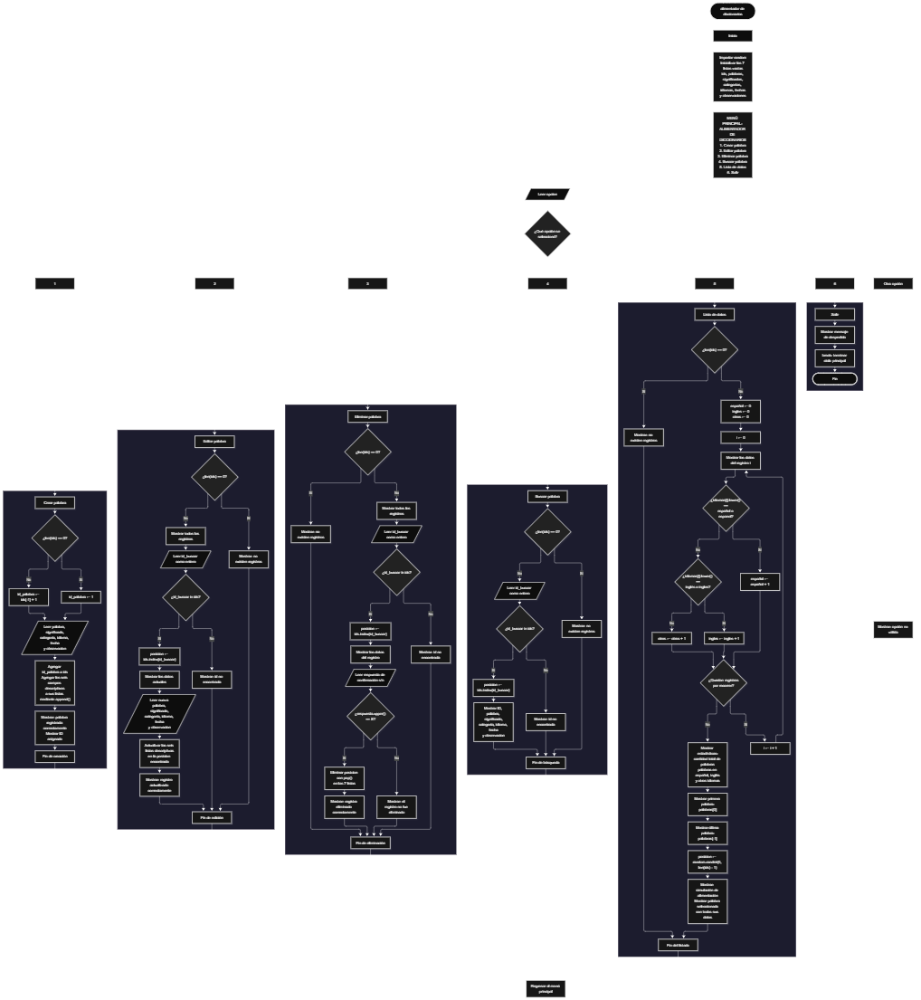

Este proyecto, llamado <b>alimentador de diccionarios</b>, fue desarrollado en <b>python</b> como un ejercicio práctico para fortalecer la lógica de programación mediante la creación de un sistema de gestión de palabras desde la consola. El programa cuenta con un menú principal de seis opciones que permite <b>crear, editar, eliminar, buscar y listar palabras</b>, además de finalizar la ejecución. Cada palabra almacena información como su significado, categoría, idioma, fecha y observaciones, utilizando siete listas paralelas para organizar los registros durante la ejecución. Durante su desarrollo se aplicaron conceptos fundamentales de programación, como variables, listas, estructuras condicionales, ciclos repetitivos, estructuras de selección, búsqueda por identificador, contadores y selección aleatoria. Asimismo, el sistema calcula estadísticas según el idioma de las palabras registradas y realiza una simulación de alimentación del diccionario mediante la selección aleatoria de uno de los registros existentes. Este proyecto permite poner en práctica los conocimientos adquiridos en python y sirve como base para desarrollar sistemas de gestión de información más avanzados.

<h2 align="center">⚙️ Funcionamiento del menú principal</h2>

### ➕ Crear palabra

La opción <b>1) crear palabra</b> permite registrar una nueva palabra en el sistema. Antes de solicitar los datos, el programa comprueba si existen registros almacenados mediante la condición <b>len(ids) == 0</b>. Si la lista está vacía, asigna el identificador inicial <b>1</b> a la variable <b>id_palabra</b>. En caso contrario, obtiene el último identificador registrado mediante <b>ids[-1] + 1</b>, utilizando el resultado como nuevo ID. Después, solicita la <b>palabra, el significado, la categoría, el idioma, la fecha y la observación</b>. Los datos se almacenan en sus respectivas listas mediante la instrucción <b>append()</b>, manteniendo la misma posición para cada campo de un registro. Finalmente, muestra el mensaje <b>"palabra registrada correctamente."</b> e informa el identificador asignado. El programa no comprueba si la palabra ya existe ni valida que los campos introducidos estén completos.

### ✏️ Editar palabra

La opción <b>2) editar palabra</b> permite modificar la información de una palabra registrada. Primero, el programa comprueba si existen registros mediante la condición <b>len(ids) == 0</b>. Si no hay palabras almacenadas, muestra el mensaje <b>"no existen registros."</b>. En caso contrario, utiliza un ciclo <b>for</b> con <b>range(len(ids))</b> para mostrar todos los registros y sus respectivos datos. Después, solicita el identificador mediante <b>int(input(...))</b> y comprueba si existe utilizando la condición <b>id_buscar in ids</b>. Si encuentra el ID, obtiene la posición correspondiente con <b>ids.index(id_buscar)</b> y muestra los datos actuales de la palabra. A continuación, solicita el nuevo valor de cada campo descriptivo y actualiza las listas <b>palabras, significados, categorias, idiomas, fechas y observaciones</b> en la posición encontrada. El identificador permanece sin cambios. Finalmente, muestra el mensaje <b>"registro actualizado correctamente."</b>. Si el ID no existe, presenta el mensaje <b>"id no encontrada."</b>.

### 🗑️ Eliminar palabra

La opción <b>3) eliminar palabra</b> permite eliminar un registro del sistema mediante su identificador. Antes de iniciar la operación, comprueba si existen palabras almacenadas. Si no hay registros, muestra el mensaje <b>"no existen registros."</b>. De lo contrario, presenta la lista completa de palabras y solicita el ID que se desea eliminar. El programa verifica su existencia mediante <b>id_buscar in ids</b> y obtiene su posición utilizando <b>ids.index(id_buscar)</b>. Si el registro existe, muestra todos sus datos y solicita confirmación mediante la pregunta <b>"¿desea eliminar este registro? (s/n):"</b>. Cuando la respuesta, convertida a mayúscula mediante <b>respuesta.upper()</b>, es igual a <b>"S"</b>, elimina la posición correspondiente de las siete listas utilizando <b>pop(posicion)</b>. De esta manera, los datos de las listas continúan relacionados por su posición. Finalmente, muestra el mensaje <b>"registro eliminado correctamente."</b>. Si el usuario no confirma la operación, presenta el mensaje <b>"el registro no fue eliminado."</b>. Si el ID no existe, informa que no se encontró.

### 🔎 Buscar palabra

La opción <b>4) buscar palabra</b> permite localizar un registro mediante su identificador. Primero, el programa comprueba si existen palabras almacenadas. Si no hay registros, muestra el mensaje <b>"no existen registros."</b>. En caso contrario, solicita el ID mediante <b>int(input(...))</b> y comprueba si está presente en la lista <b>ids</b>. Cuando encuentra una coincidencia, utiliza <b>ids.index(id_buscar)</b> para obtener la posición del registro y muestra el identificador, la palabra, el significado, la categoría, el idioma, la fecha y la observación. Si no encuentra el ID solicitado, presenta el mensaje <b>"id no encontrada."</b>. Esta operación permite consultar individualmente un registro sin modificar ni eliminar sus datos.

### 📋 Lista de datos

La opción <b>5) lista de datos</b> permite visualizar todas las palabras registradas y obtener estadísticas sobre su distribución por idioma. Primero, el programa comprueba si existen registros. Si la lista está vacía, muestra el mensaje <b>"no existen registros."</b>. Si hay palabras almacenadas, inicializa los contadores <b>español, ingles y otros</b> con el valor <b>0</b> y utiliza un ciclo <b>for</b> para recorrer y mostrar todos los registros. Durante el recorrido, compara el idioma de cada palabra utilizando <b>idiomas[i].lower()</b>. Si el idioma es <b>"español"</b> o <b>"espanol"</b>, incrementa el contador <b>español</b>. Si es <b>"inglés"</b> o <b>"ingles"</b>, incrementa <b>ingles</b>. Cualquier otro valor se contabiliza en <b>otros</b>. Al finalizar, muestra la cantidad total de palabras y las estadísticas de los tres grupos. También presenta la primera palabra mediante <b>palabras[0]</b> y la última mediante <b>palabras[-1]</b>. Finalmente, utiliza <b>random.randint(0, len(ids) - 1)</b> para seleccionar una posición aleatoria y mostrar el registro elegido como una palabra agregada al diccionario. Esta última acción representa una simulación: no incorpora el registro a un diccionario externo ni conecta el programa con una base de datos real.

### 🚪 Salir del menú principal

La opción <b>6) salir</b> permite finalizar la ejecución del programa. Cuando el usuario selecciona esta opción, el sistema muestra el mensaje <b>"gracias por utilizar el alimentador de diccionarios."</b> y ejecuta la instrucción <b>break</b>, que interrumpe el ciclo principal <b>while True</b>. De esta manera, el programa deja de mostrar el menú y termina su ejecución. Si el usuario introduce un valor que no coincide con ninguna de las seis opciones disponibles, el bloque <b>else</b> muestra el mensaje <b>"opción no válida."</b> y el ciclo continúa activo.

<h2 align="center">🧠 Temas aplicados en el proyecto</h2>

### 📦 Variables

En este proyecto se utilizan variables para controlar la opción seleccionada en el menú, asignar identificadores, almacenar temporalmente los datos introducidos por el usuario, localizar registros y calcular estadísticas. También se emplean variables de posición para acceder a los elementos relacionados de las listas y una variable para almacenar la respuesta de confirmación durante la eliminación de una palabra.

📝 **Opcion:** almacena la opción seleccionada por el usuario en el menú principal.

🔢 **Id_palabra:** almacena el identificador que se asigna al crear una palabra.

🔎 **Id_buscar:** almacena el identificador introducido para localizar un registro.

📍 **Posicion:** indica la posición del registro encontrado dentro de las listas.

🔄 **I:** funciona como contador en los ciclos utilizados para recorrer los registros.

📊 **Español:** cuenta las palabras cuyo idioma se reconoce como español.

📊 **Ingles:** cuenta las palabras cuyo idioma se reconoce como inglés.

📊 **Otros:** cuenta las palabras que no coinciden con los idiomas contemplados expresamente.

🎲 **Respuesta:** almacena la confirmación introducida por el usuario durante la eliminación de un registro.

### 🗃️ Listas

El programa utiliza siete listas paralelas para almacenar la información de las palabras registradas. Todas mantienen una relación por posición, de manera que los elementos que comparten el mismo índice pertenecen a un mismo registro. Por ejemplo, la información de la posición <b>0</b> se encuentra distribuida entre <b>ids[0], palabras[0], significados[0], categorias[0], idiomas[0], fechas[0] y observaciones[0]</b>. Esta organización permite recorrer, buscar, modificar, mostrar y eliminar registros de manera coordinada durante la ejecución.

🆔 **Ids:** almacena los identificadores numéricos de los registros.

📖 **Palabras:** almacena las palabras registradas.

📝 **Significados:** almacena el significado asociado a cada palabra.

🗂️ **Categorias:** almacena la categoría de cada palabra.

🌐 **Idiomas:** almacena el idioma indicado para cada registro.

📅 **Fechas:** almacena la fecha asociada a cada palabra.

📌 **Observaciones:** almacena las observaciones adicionales de cada registro.

### 🔀 Estructuras condicionales

En este proyecto se utilizan las estructuras <b>if, elif y else</b> para controlar las opciones del menú y determinar las instrucciones que deben ejecutarse según cada situación. Estas estructuras permiten comprobar si existen registros antes de realizar una operación, verificar si un identificador está almacenado, confirmar la eliminación de una palabra y clasificar los registros según el idioma. También se emplea el bloque <b>else</b> para mostrar un mensaje cuando el usuario introduce una opción que no está contemplada en el menú.

### 🔄 Estructuras repetitivas

El programa utiliza los ciclos <b>while</b> y <b>for</b> para ejecutar las operaciones de gestión de palabras. El ciclo <b>while True</b> mantiene activo el menú principal hasta que se selecciona la opción de salida y se ejecuta <b>break</b>. Los ciclos <b>for</b>, acompañados de <b>range(len(ids))</b>, permiten recorrer las listas para mostrar los registros durante las operaciones de edición, eliminación y listado. En la opción de estadísticas, el recorrido también permite clasificar las palabras por idioma y actualizar los contadores correspondientes.

### 🎯 Selección de opciones

El programa utiliza una estructura condicional basada en <b>if, elif y else</b> para comparar la variable <b>opcion</b> con los valores introducidos por el usuario. Cada condición corresponde a una de las seis operaciones del menú: <b>crear palabra, editar palabra, eliminar palabra, buscar palabra, lista de datos y salir</b>. Si el valor introducido no coincide con ninguna de estas opciones, se ejecuta el bloque <b>else</b>, que muestra el mensaje <b>"opción no válida."</b>.

### 🔍 Búsqueda por identificador

La búsqueda de registros se realiza mediante la comprobación <b>id_buscar in ids</b>, que permite determinar si el identificador solicitado existe en la lista. Cuando se encuentra, el método <b>ids.index(id_buscar)</b> devuelve su posición. Esta posición se utiliza para acceder a los datos relacionados en las demás listas, lo que permite consultar, modificar o eliminar el registro correspondiente sin recorrer manualmente cada lista para encontrar su ubicación.

### 🔢 Contadores y estadísticas

El programa utiliza tres contadores para calcular la cantidad de palabras clasificadas como español, inglés y otros idiomas. Antes de recorrer los registros, las variables <b>español, ingles y otros</b> se inicializan en cero. Durante el ciclo, el programa compara el idioma de cada registro después de aplicar <b>lower()</b> y aumenta el contador correspondiente. Al terminar el recorrido, muestra el total de palabras almacenadas y las cantidades obtenidas para cada grupo. La clasificación depende del texto introducido en el campo del idioma y no de una validación previa.

### 🎲 Selección aleatoria

El módulo <b>random</b> se importa al inicio del programa y se utiliza en la opción <b>lista de datos</b> para seleccionar un registro aleatorio. La instrucción <b>random.randint(0, len(ids) - 1)</b> genera un número entero dentro del rango de índices existentes. El resultado se almacena en la variable <b>posicion</b> y permite mostrar los datos completos de la palabra seleccionada. Esta operación simula la alimentación del diccionario, pero no guarda la palabra en un sistema externo.

### 🔤 Manipulación de cadenas

El programa utiliza los métodos <b>lower()</b> y <b>upper()</b> para comparar textos sin depender de determinadas diferencias entre mayúsculas y minúsculas. En la clasificación de idiomas, <b>lower()</b> transforma el texto a minúsculas antes de compararlo con los valores esperados. Durante la eliminación, <b>upper()</b> convierte la respuesta de confirmación a mayúsculas para comprobar si es igual a <b>"S"</b>. Estas operaciones facilitan la comparación de cadenas, aunque no eliminan otras diferencias, como espacios adicionales o errores de escritura.

### 🧮 Operaciones con listas

Las listas se administran mediante diferentes operaciones de Python. El método <b>append()</b> incorpora nuevos datos al final de cada lista durante el registro de una palabra. El método <b>pop(posicion)</b> elimina el elemento ubicado en la posición seleccionada durante la eliminación de un registro. Además, las expresiones <b>ids[-1]</b>, <b>palabras[0]</b> y <b>palabras[-1]</b> permiten acceder, respectivamente, al último identificador, la primera palabra y la última palabra almacenada. Estas operaciones facilitan la administración de los registros durante la ejecución.

<h2 align="center">¿Cómo se implementaron las operaciones crud en el proyecto?</h2>

Las operaciones <b>crud</b> se implementaron mediante las opciones del menú principal para administrar los registros de palabras. La operación <b>crear</b> corresponde a <b>crear palabra</b>, donde se solicitan los datos y se incorporan a las listas mediante <b>append()</b>. La operación <b>leer</b> se realiza mediante las opciones <b>buscar palabra y lista de datos</b>, que permiten consultar un registro específico o visualizar todos los registros junto con sus estadísticas. La operación <b>actualizar</b> corresponde a <b>editar palabra</b>, donde se modifican los campos descriptivos de un registro existente. Finalmente, la operación <b>eliminar</b> se implementa mediante <b>eliminar palabra</b>, que solicita confirmación y elimina la posición correspondiente de las siete listas. Todas estas operaciones trabajan con datos almacenados temporalmente en la memoria del programa.

<h2 align="center">Diagrama de flujo del proyecto</h2>

<h2 align="center">🛡️ Validaciones del programa</h2>

### 📭 No existen registros

Esta comprobación se utiliza en las opciones <b>editar palabra, eliminar palabra, buscar palabra y lista de datos</b>. El programa evalúa la condición <b>len(ids) == 0</b> para determinar si existen registros almacenados. Si la lista está vacía, muestra el mensaje <b>"no existen registros."</b> y no continúa con la operación solicitada. Esta comprobación evita acceder a posiciones de las listas cuando todavía no se han registrado palabras.

### 🔎 Identificador no encontrado

En las operaciones de edición, eliminación y búsqueda, el programa comprueba si el identificador introducido está presente en la lista <b>ids</b>. Si existe, obtiene su posición mediante <b>ids.index(id_buscar)</b> y accede a los datos asociados. Si no existe, muestra el mensaje <b>"id no encontrada."</b>. Esta comprobación permite evitar modificaciones o eliminaciones sobre un identificador que no está registrado. Sin embargo, la conversión inicial mediante <b>int(input(...))</b> no contempla entradas que contengan texto no numérico, por lo que estas pueden generar un error.

### 🗑️ Confirmación de eliminación

Antes de eliminar un registro, el programa muestra sus datos y solicita una respuesta mediante la pregunta <b>"¿desea eliminar este registro? (s/n):"</b>. La condición <b>respuesta.upper() == "S"</b> permite confirmar la operación cuando el usuario introduce la letra <b>s</b> o <b>S</b>. Si la respuesta no coincide con ese valor, el registro se conserva y se muestra el mensaje <b>"el registro no fue eliminado."</b>. El programa no valida expresamente que la respuesta sea únicamente <b>s</b> o <b>n</b>; cualquier otro valor también cancela la eliminación.

### 🌐 Clasificación de idiomas

Durante el listado, el programa clasifica cada registro según el contenido de la lista <b>idiomas</b>. Reconoce las variantes <b>"español"</b>, <b>"espanol"</b>, <b>"inglés"</b> e <b>"ingles"</b> después de convertir el texto a minúsculas mediante <b>lower()</b>. Los valores que no coinciden con estas opciones se contabilizan como otros idiomas. Esta clasificación no verifica si el idioma introducido es válido, por lo que los campos vacíos, los errores de escritura y los idiomas diferentes también se incluyen en el contador de otros idiomas.

### ⚠️ Opción no válida

El bloque <b>else</b> del menú principal se ejecuta cuando la variable <b>opcion</b> no coincide con ninguna de las opciones definidas. En ese caso, muestra el mensaje <b>"opción no válida."</b> y permite que el ciclo <b>while True</b> continúe. El programa no convierte la opción a un número, sino que compara el texto introducido con las cadenas <b>"1"</b>, <b>"2"</b>, <b>"3"</b>, <b>"4"</b>, <b>"5"</b> y <b>"6"</b>.

### 💾 Almacenamiento temporal

Los registros se almacenan en listas creadas al inicio del programa y permanecen disponibles mientras la ejecución continúa. El código no utiliza archivos, bases de datos ni mecanismos de persistencia para guardar los registros. Por este motivo, al finalizar el programa, la información almacenada en las listas se pierde. Asimismo, el sistema no establece una capacidad máxima de palabras ni valida que todos los campos estén completos antes de guardar un registro.

<h2 align="center">🎯 Objetivo del proyecto</h2>

El objetivo principal de este proyecto es fortalecer la <b>lógica de programación</b> mediante el desarrollo de un sistema de gestión de palabras en <b>python</b>. A través de su construcción se busca aplicar los conocimientos adquiridos sobre variables, listas, estructuras condicionales, ciclos repetitivos, búsqueda por identificador, manipulación de cadenas y contadores, integrándolos para resolver un problema de manera organizada. Además, el proyecto permite comprender cómo registrar, consultar, modificar y eliminar información, calcular estadísticas a partir de los datos almacenados y utilizar la selección aleatoria para simular un proceso de alimentación de un diccionario. Esta implementación constituye una base para desarrollar sistemas de gestión más completos, incorporar almacenamiento persistente y conectar futuras aplicaciones con diccionarios o bases de datos reales.

